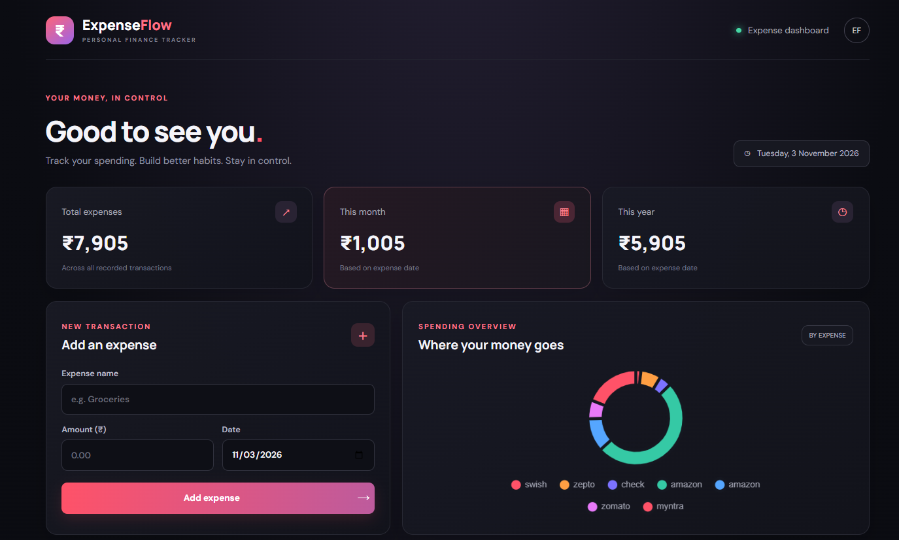
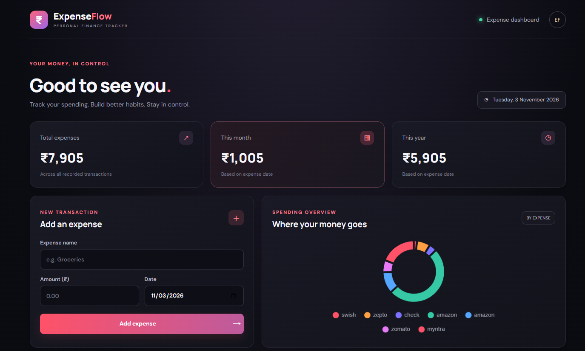

# 💸 ExpenseFlow

### Smart Expense Tracking & Financial Management

ExpenseFlow is a full-stack expense management application designed to help users record, manage, and monitor their daily expenses through a clean and responsive interface.

## 🚀 Features

- 📊 Expense dashboard with summary cards
- ➕ Add new expense records
- 📋 View expense transaction history
- 🗑️ Delete expense records
- 📈 Visual expense analytics and charts
- 💾 Persistent data storage using MySQL
- 📱 Responsive user interface
- ⚡ Progressive Web App (PWA) support

## 📸 Application Screenshots

### Dashboard



### Recent Expenses



## 🛠️ Tech Stack

| Technology      | Purpose                        |
| --------------- | ------------------------------ |
| React.js        | Frontend                       |
| JavaScript      | Application logic              |
| HTML5 & CSS3    | UI and styling                 |
| Java Servlets   | Backend                        |
| JDBC            | Database connectivity          |
| MySQL           | Database                       |
| Apache Tomcat 9 | Application server             |
| Vite            | Frontend development and build |

## 🏗️ System Architecture

```text
React Frontend
      |
      | Fetch API (HTTP)
      v
Apache Tomcat
      |
      v
Java Servlet
      |
      v
JDBC + MySQL Connector
      |
      v
MySQL Database
```

## 📂 Project Structure

```text
ExpenseFlow/
│
├── src/
│   ├── components/
│   │   ├── ExpenseChart.jsx
│   │   ├── ExpenseForm.jsx
│   │   ├── ExpenseList.jsx
│   │   └── SummaryCard.jsx
│   ├── App.jsx
│   ├── main.jsx
│   └── styles.css
│
├── WEB-INF/
│   ├── classes/
│   ├── lib/
│   └── web.xml
│
├── database/
│   └── expenseflow.sql
│
├── ExpenseServlet.java
├── index.html
├── package.json
├── vite.config.js
└── README.md
```

## ⚙️ Installation & Setup

### 1. Clone the repository

```bash
git clone https://github.com/Karan-21-2004/ExpenseFlow.git
cd ExpenseFlow
```

### 2. Install frontend dependencies

```bash
npm install
```

### 3. Configure MySQL

- Start your MySQL server.
- Create the database using `database/expenseflow.sql`.
- Configure the following environment variables:

```text
DB_URL=jdbc:mysql://localhost:3306/expenseflow_db
DB_USER=your_mysql_username
DB_PASSWORD=your_mysql_password
```

Use your actual database name from the SQL script.

### 4. Configure the backend

- Configure Apache Tomcat 9.
- Add the MySQL Connector/J library.
- Compile and deploy the Java Servlet.
- Configure the environment variables for the Tomcat process.

### 5. Run the frontend

```bash
npm run dev
```

### 6. Build the frontend

```bash
npm run build
```

Deploy the generated frontend build with the Java Servlet application on Tomcat.

## 🔐 Security

Database credentials are read through environment variables rather than hardcoded in the Java source code.

Never commit passwords, API keys, or private configuration files.

## 🔮 Future Improvements

- User authentication and authorization
- Monthly and yearly expense reports
- Budget planning and tracking
- Export expense reports
- Advanced financial analytics

## 👨‍💻 Developer

**Karan**

B.Tech Computer Science & Engineering

GitHub: [Karan-21-2004](https://github.com/Karan-21-2004)

---

⭐ If you find this project useful, consider giving it a star!
